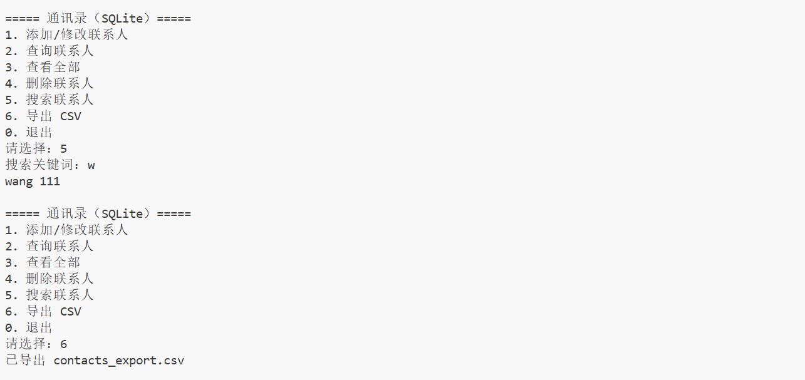

# 联系人管理系统（CLI + SQLite）

一个用 Python 写的命令行联系人管理工具，支持增删改查、模糊搜索和 CSV 导出，数据保存在本地 SQLite 数据库中。

## 功能

- 添加 / 修改联系人（姓名 + 电话）
- 按姓名精确查询
- 查看全部联系人
- 删除联系人
- 按关键词模糊搜索
- 导出 CSV（Excel 可直接打开）
- 输入校验：姓名不能为空、电话必须为数字

## 技术栈

- Python 3.12
- SQLite（Python 内置 `sqlite3`）
- 标准库 `csv`

## 运行

```bash
python contacts.py
```

无需安装第三方依赖。首次运行会自动创建 `contacts.db` 并建表。

## 使用示例




## 数据库设计

表 `contacts`：

| 字段 | 类型 | 说明 |
|---|---|---|
| name | TEXT | 主键，唯一 |
| phone | TEXT | 电话 |

## 为什么用 SQLite

- 单文件、无需安装服务器
- 支持 SQL 直接增删改查，不用整体重写文件
- 适合本地小工具、数据量不大
- Python 自带 sqlite3，零依赖


## 设计与取舍

### 1. SQL 为什么用占位符，不用 f-string 拼接？

防注入（输入会被当成 SQL 执行，`' OR 1=1 --` 直接泄露全表），也避免引号转义（O'Brien 这类直接拼会语法报错）。

### 2. 写 CSV 为什么用 utf-8-sig 编码？

Excel 不认无 BOM 的 UTF-8，打开中文会乱码；加 BOM 它才识别编码。

### 3. 写 CSV 为什么要加 newline 参数？

否则 Windows 下 csv 模块自带 `\r\n`，Python 文本层再转一次变成 `\r\r\n`，每行之间就多一个空行。

### 4. .gitignore 为什么要排除 .db 文件？

db 是二进制的个人测试数据，diff 看不了、多人会冲突、可能含敏感信息；代码进仓库，数据不进。

### 5. 删数据为什么 SQL 直接删行，文本文件要整体重写？

文本文件只是一长串字节，没有行的概念，删一行只能全读全写；数据库每行是独立记录带索引，`DELETE` 直接定位那一行，毫秒级，而且有事务和日志，异常中断后能恢复到一致状态。

## 项目结构

```
contacts-app/
├── contacts.py
├── README.md
└── .gitignore
```

## 后续计划

- [ ] 单元测试（pytest）
- [ ] 支持导出 JSON
- [ ] 增加图形界面（Streamlit）
